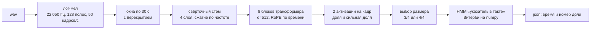

# Доли и сильные доли в песне: своя нейросеть

Тестовое задание стартапа Qildo (задача 4). Сервис раскладывает песню на дорожки и пишет по ним ноты, и ему нужно знать, где в треке доли и где начинается такт. Модель и постобработку я обучил и написал с нуля, чужих весов нет.

Здесь только описание архитектуры и цифры. Код и веса закрыты, пока Qildo проверяет решение.

```
python beats.py song.wav out.json
→ [{"time": 0.512, "beat": 1}, {"time": 1.004, "beat": 2}, ...]   # beat 1 = сильная доля
```

Песня на 4:28 обрабатывается за 13 с на CPU (Ryzen 7 5700X3D) или за 8 с на RTX 3060 Ti, без интернета, видеопамяти нужно меньше 1 ГБ.

English summary: a beat and downbeat tracker trained from scratch (conv stem + 8-layer RoPE transformer, 25.7M params, custom bar-pointer HMM with Viterbi). Beat F-measure 0.977 on live drums with music, 0.953 on Slakh test. Code and weights stay private while the company reviews the task.

## Как устроено



1. Признаки. Лог-мел-спектрограмма: 22 050 Гц, 128 полос, 50 кадров в секунду.
2. Свёрточный стем. Первая свёртка сразу сжимает частоту в 4 раза, потом три свёртки 3×3 с пулингом только по частоте. Время не сжимается, у каждого кадра остаётся свой вектор.
3. Трансформер. 8 блоков, ширина 512, позиции через RoPE, поэтому окно любой длины. Идею «свёртки, потом трансформер» я взял из статьи Beat This! (Foscarin и др., ISMIR 2024), код свой.
4. Функция потерь. Своя BCE с допуском ±3 кадра (±60 мс): ручная разметка долей всегда немного гуляет, и сеть не штрафуется за попадание рядом.
5. Длинная песня режется на окна по 30 с с перекрытием и сшивается обратно.
6. Размер такта. HMM почти всегда выбирала такт на 4, поэтому размер выбирается отдельно, по контрасту активации сильной доли на каждой 3-й и 4-й доле.
7. Постобработка. Своя HMM «указатель в такте» (идея Krebs и Böck) с декодированием Витерби. Темп может меняться только на границе доли, есть априорное распределение темпа. Это и убирает три главные ошибки: темп вдвое, сдвиг сильной доли и пропуск начала. Параметры подбирал на отложенных данных и слепым прослушиванием с метрономом, тест для этого не трогал.

## Данные

Всё с лицензией, разрешающей коммерческое использование:

- Lakh MIDI (CC BY), около 16,6 тыс. песен, отрендеренных своим скриптом через FluidSynth с открытыми саундфонтами. Отдельно рендеры со свободным темпом и вальсы 3/4.
- Slakh2100 (CC BY 4.0) и Groove MIDI (CC BY 4.0): 13 часов живых барабанщиков под клик.
- GuitarSet (ручная разметка).
- Free Music Archive: 2475 треков рока и попа только под CC BY и CC0. Их разметили две мои модели, в обучение взял 967 треков, где модели согласны.
- Растяжка по темпу ±25 % на всех источниках.

Обучал на одной RTX 3060 Ti (8 ГБ): предобучение на синтетике, потом несколько кругов дообучения с псевдоразметкой.

## Цифры

mir_eval, окно ±70 мс, первые 5 секунд не отбрасываются. Ни один из этих наборов не участвовал в обучении и подборе параметров.

| Набор | Песен | F по долям | F по сильным долям | CMLt | AMLt |
|---|---|---|---|---|---|
| Живые барабаны + музыка | 47 | 0,977 | 0,913 | 0,964 | 0,986 |
| Живые барабаны, рок и поп | 19 | 0,974 | 0,868 | 0,937 | 0,990 |
| Живые барабаны, свинг, шаффл, фанк | 17 | 0,975 | 0,861 | 0,976 | 0,976 |
| Медленные песни (< 90 BPM) | 56 | 0,905 | 0,833 | 0,862 | 0,910 |
| Slakh test | 117 | 0,953 | 0,885 | 0,922 | 0,944 |
| GuitarSet, соло-гитара | 60 | 0,663 | 0,546 | 0,562 | 0,704 |
| Голос + фортепиано (Winterreise) | 48 | 0,413 | 0,265 | 0,163 | 0,466 |

На 150 отложенных песнях темп совпал с BPM, который указал автор, в 105 случаях из 150.

## Что не получилось

- Свободный темп (rubato, классика, голос с фортепиано) остаётся слабым местом: F по долям около 0,41.
- Рендеры в 6/8 улучшали вальсы, но заставляли модель удваивать темп медленного рока (68 → 136 BPM). Убрал их.
- Более гибкая HMM поднимала F сильных долей, но на слух сетка начинала плыть. Чтобы это мерить, ввёл свою метрику плавания (сколько долей отличается от соседних больше чем на 6 %) и оставил более жёсткую HMM.
- Ансамбль из двух версий оказался хуже одной лучшей: среднее активаций размывает её выигрыш.
- Свинговые восьмые модель всё ещё иногда считает долями, и темп выходит вдвое.

## Автор

Глеб, 2 курс мехмата БГУ. Код писал вместе с Claude Code: задачу ставил, делил на проверяемые шаги, данные, метрики и слепое прослушивание делал я. Telegram @nivokvo, другие проекты: [github.com/nivokvo/portfolio](https://github.com/nivokvo/portfolio).
